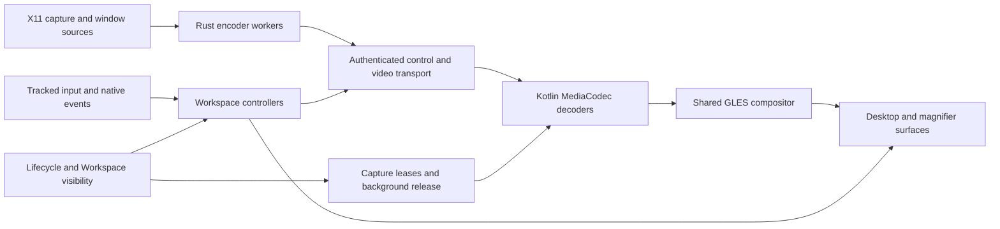

# Runtime review and refactor — 16 November 2026

## Scope and decision

The review covers the runtime boundaries across the X11/Rust host, Kotlin XR client, shared wire protocol, desktop tooling and regression harnesses (103 Rust/Kotlin/Python/shell source files at the start of the review). It focuses on update cadence, allocation, ownership, blocking work, coordinate consistency and maintainable module boundaries. It preserves the confirmed gesture, projection and display-layout behavior rather than replacing functioning algorithms wholesale.

Keep Rust for capture, encoding and transport, and Kotlin for the Android XR SDK integration. MediaCodec, GLES, XRender, GStreamer and SceneCore already perform the expensive work natively. A framework/language rewrite would not remove native command queues, unnecessary updates or thermal throttling, and would introduce another interoperability/lifetime boundary. Revisit isolated compute kernels only if device profiling demonstrates that managed computation dominates.

Current headset thermal state could not be measured: neither USB nor wireless ADB discovery found a headset. The previous connected reading was severe thermal status with CPU throttling. Available memory and stream FPS do not establish headset compositor health. Resource telemetry now includes Android's thermal severity; the HUD shows it as `T:normal`, `T:severe`, etc., and reports unavailable readings explicitly.

## Responsibilities

| Area | Owner | Change or review outcome |
| --- | --- | --- |
| Android startup and permissions | `MainActivity.kt` | Reduced from 2,049 to approximately 54 lines. Session ownership is Activity-scoped; anchor work uses lifecycleScope rather than an uncancelled independent scope. |
| XR workspace orchestration | `WorkspaceRuntime.kt` | Owns lifecycle, tracked inputs and workspace/controller coordination. No process-global Session reference remains. |
| Desktop presentation | `DesktopScene.kt` | Scene surfaces, native handles, pointer presentation and Workspace UI placement are separate from startup. |
| Input and geometry adapters | `WorkspaceInteraction.kt` | Shared transforms, quaternion rotation, normalization, hand geometry and native event conversions. The confirmed hit-coordinate conversion remains unchanged. |
| Magnifier policies | `WindowMagnification.kt`, `MagnifierContacts.kt` | Floating/fixed panes share projection; desktop and magnifier rotation reuse the same quaternion implementation. Hover ownership has one update/clear path. Rendering and hit routing use one visibility policy. |
| Native mesh storage | `NativeSurfaceResources.kt`, `BoundedHistory.kt` | Desktop and magnifier uploads share validation, direct-buffer construction and retention. Entry limits also have byte budgets: 64 MiB for desktop upload history and 16 MiB per magnifier. These budgets cover retained CPU upload buffers, not total GPU/decoder memory. |
| Window capture | `WindowCapturePool.kt`, `WindowCaptureFormat.kt` | One source/codec per unique window remains shared across mirrors and desktop patch. Allocation and decoder validation share size bounds. Buffer-size setters run only when encoded size changes. Closed outputs cannot receive delayed ready callbacks. |
| Teardown | `BackgroundRelease.kt` | Producers stop immediately; decoder/GL joins run off the UI thread. Hiding several panes no longer serializes their join timeouts onto input processing. |
| GLES compositor | `media/VideoCompositor.kt` | Uniform/attribute locations are cached per program. Beam/ring vertices reuse bounded primitive/direct buffers rather than boxing a list of Floats and allocating upload storage every draw. Projection, opaque priority, UVs and source mapping are preserved. |
| Host session coordinator | `session.rs` | Reduced from 2,146 to about 1,187 lines. Coordinates lifecycle and state rather than implementing every transport and pixel operation. |
| Stream workers | `session/streaming.rs` | Encoder/worker ownership and pacing. Video destination fields travel together instead of positional peer/destination/index arguments. |
| Control/discovery | `session/transport.rs` | Authenticated input routing, pointer mapping, hello/layout publication and discovery. |
| Cursor and receiver | `session/cursor.rs`, `session/receiver.rs` | Cursor painting is reusable by stream paths; the diagnostic receiver is independent. |
| Dynamic streaming | `session/detail.rs` and submodules | Frame-request metadata is grouped in a typed context. Existing resource adaptation, sampling density, crop mapping and baseline handoff are preserved and integration-tested. |
| X11 display management | `monitor_pool.rs`, `monitor_watch.rs` | Persistent event-driven RandR observation and IBus-isolated Qt helpers remain. Low-rate operation responsiveness and priority preservation are retained. Removed an unused capture wrapper. |
| Wire protocol | `crates/protocol` | Binary layouts and packet bounds preserved. Malformed RTP returns a named error instead of unit error; allocation division uses checked arithmetic. |
| Tooling | `scripts` | All production Python scripts formatted; formatting verified against parsed ASTs. Unused imports removed. Setup tooling retains its existing authorization and active-topology guards. |
| Verification | `scripts/verify.py`, `checks/production_sources.py` | Shared source loading follows the new module boundaries. One verifier runs Rust/style/JVM/integration/Android groups, with sequential JVM tests and a default 512 MiB heap. |



## Behavior and performance invariants

- Workspace opening hides magnifier surfaces, colliders, gaze interception and transient menus, including pinned panes. Capture leases stop while hidden; placements and pin locks survive the temporary suspension.
- Fixed panes also suspend when the scene is no longer active. Readiness is cleared when hidden, preventing an invisible pane from intercepting gaze before its next first frame.
- Native custom-mesh parameters are validated before JNI; original buffers are retained before native submission. This is defensive ownership, not proof that the previously observed SDK crash is eliminated.
- Pose updates remain display-paced; curved geometry uploads retain their separate budgets. Shared projection checks the old mesh before rebuilding it.
- The source-capture gain and initiating hand stay fixed throughout magnifier dragging. Contact thresholds and binary rearming are not retuned by the refactor.
- Focus, Reset and HUD reuse the same view-fit bounds and canonical scene radii. Framebuffer and codec safety bounds remain explicit contracts rather than inferred from available RAM.
- Host protocol, combined desktop arrangement, priorities and virtual refresh-rate selection retain their existing semantics. Hardware pixel throughput is not inferred from source-code structure.

## Validation and remaining evidence

Completed: Rust workspace tests, Clippy with warnings denied, rustfmt, Python Ruff lint/format, all 22 platform-substituted JVM checks, Android assemble/lint, private Xvfb/KWin capture/focus/typing/RandR checks, slow display-operation heartbeats, offscreen tray polling checks, and live private-X11 dynamic streaming/encoder reconstruction checks. Changed shared-math and native-buffer checks were rerun after consolidation.

These tests validate algorithms, protocol identity, request handling and ownership invariants. Private-X11 stream profiles are functional test workloads, not before/after throughput measurements on the user's headset. No headset performance improvement, current thermal state, native hit ordering or native-renderer crash stability is claimed without connected-device testing.

The remaining highest-value measurements are per-thread XR frame time, native mesh submission time/queue pressure, thermal severity during sustained use, decoder/GL teardown duration, and capture/encoder load with several different pinned sources. High-rate hand sampling remains because it protects quick pinch detection; changing its cadence needs device evidence. The workspace coordinator still contains a large tracked-input transaction, deliberately kept coherent until its device behavior can be profiled and split further without losing event ordering.

## Reproducing checks

```sh
python3 scripts/verify.py
python3 scripts/verify.py --group integration
python3 scripts/verify.py --group android
python3 scripts/verify.py --group jvm --only jvm-focus_interaction
```

The verifier prints a temporary directory containing complete per-check logs. Pass `--gradle-lib /path/to/gradle/lib` if the Kotlin compiler distribution is not in the wrapper cache. Integration checks use private displays and prepare a release host binary; they do not launch the production headset app or reconfigure the user's desktop. Android checks require an installed SDK and cached Gradle dependencies. The GPU/device suite remains `client/android-xr/checks/video_compositor_device.py` and requires ADB.
